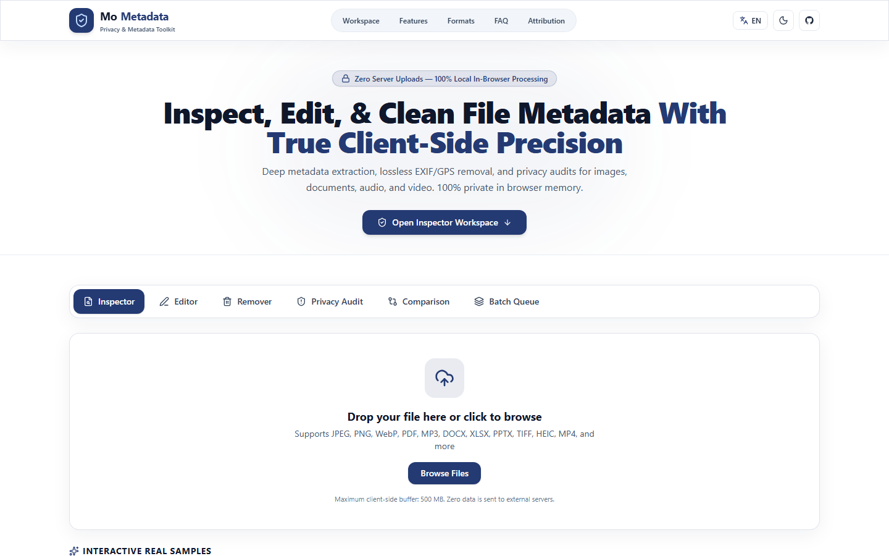
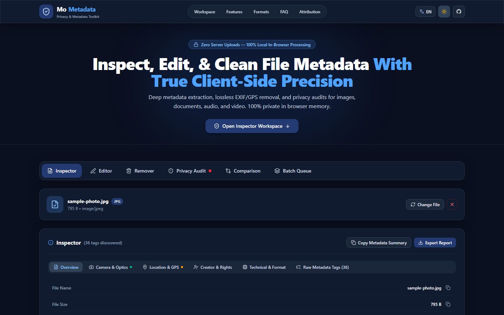
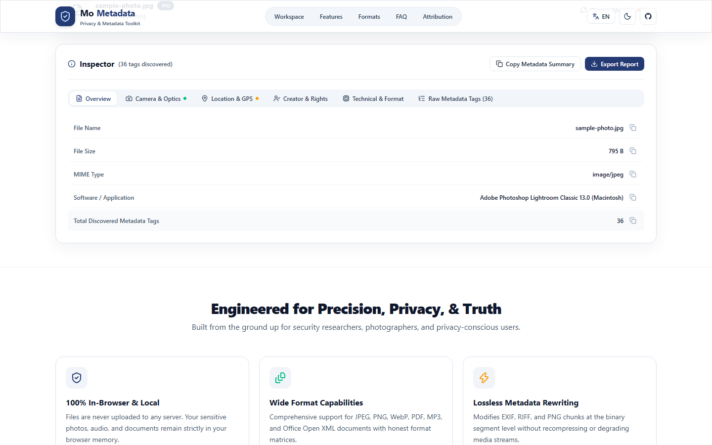

# MoMetadata — File Metadata Inspector, Editor & Privacy Toolkit

> **Inspect, edit, and sanitize file metadata with mathematical precision. 100% private, client-side in-browser processing.**

[](LICENSE)
[](https://github.com/dimasmong/MoMetadata/releases)
[](https://github.com/dimasmong/MoMetadata/actions/workflows/ci.yml)
[](https://www.typescriptlang.org/)
[](https://mometadata.vercel.app)

---

## 1. Project Overview

**MoMetadata** is a modern, standalone web application focused exclusively on file metadata management. Designed for privacy-conscious users, photographers, journalists, developers, and security analysts, MoMetadata provides a truthful, deterministic toolkit to inspect, search, edit, scrub, compare, and verify metadata from digital images, audio tracks, and documents.

### Core Principles
- **100% Client-Side Privacy**: File bytes are loaded locally via browser File, Blob, and ArrayBuffer APIs. Files never leave your device and are never transmitted to any external server.
- **Lossless Segment Processing**: Modifies binary metadata segments (EXIF, IPTC, XMP, RIFF, PNG text chunks, ID3v2, PDF Info dictionary) while preserving raw pixel and audio entropy without re-encoding.
- **Independent Verification**: Every saved or cleaned file is immediately parsed and verified before offering a download, showing exact byte deltas and sanitized tags.
- **No Automatic Downloads**: Full user sovereignty. Processed files are only downloaded when you explicitly click the Download button.
- **Bilingual Interface**: Seamless switching between **English** and **Bahasa Indonesia**.
- **Refined Glassmorphism**: Dual **Light Mode** (default) and **Dark Mode** meeting WCAG 2.1 AA contrast requirements with primary brand color `#243A73`.

---

## 2. Visual Preview

### Light Mode (Default)


### Dark Mode


### Metadata Workspace & Inspector


---

## 3. Supported Formats & Capabilities

| Format | Extensions | Inspect | Edit | Remove GPS | Sanitize Non-Essential | Verify | Notes |
| :--- | :--- | :---: | :---: | :---: | :---: | :---: | :--- |
| **JPEG / JPG** | `.jpg`, `.jpeg` | ✅ | ✅ | ✅ | ✅ | ✅ | Lossless segment rewrite preserving SOF, DQT, DHT, SOS entropy scan. ICC preserved by default. |
| **PNG** | `.png` | ✅ | ✅ | ✅ | ✅ | ✅ | Binary chunk parser/builder for `tEXt`, `iTXt`, `zTXt`, `eXIf` with IEEE 802.3 CRC32 recalculation. |
| **WebP** | `.webp` | ✅ | ✅ | ✅ | ✅ | ✅ | RIFF container parser modifying EXIF/XMP chunks with VP8X header flags synchronization. |
| **PDF** | `.pdf` | ✅ | ✅ | ✅ | ✅ | ✅ | Document Info dictionary and XMP stream modification and stripping via `pdf-lib`. |
| **MP3** | `.mp3` | ✅ | ✅ | N/A | ✅ | ✅ | ID3v1 and ID3v2 tag manipulation preserving 100% of MPEG audio frames untouched. |
| **Office Open XML** | `.docx`, `.xlsx`, `.pptx` | ✅ | ✅ | N/A | ✅ | ✅ | Safe inspection and modification of `docProps/core.xml` Dublin Core package properties. |
| **TIFF** | `.tif`, `.tiff` | ✅ | Read-only | Read-only | Read-only | N/A | Comprehensive IFD tag inspection. Writing disabled to protect complex multi-page or tiled structures. |
| **HEIC / HEIF / AVIF** | `.heic`, `.heif`, `.avif` | ✅ | Read-only | Read-only | Read-only | N/A | ISOBMFF container parsing. Read-only to avoid corrupting proprietary camera encoding boxes. |
| **GIF** | `.gif` | ✅ | Read-only | Read-only | Read-only | N/A | GIF screen descriptor and comment extension blocks inspection. |
| **MP4 / MOV / MKV / WebM** | `.mp4`, `.mov`, `.mkv`, `.webm` | ✅ | Read-only | Read-only | Read-only | N/A | ISOBMFF container atom parsing (moov, udta, meta), video dimensions, duration, and audio tracks. |
| **FLAC / WAV / OGG / AAC** | `.flac`, `.wav`, `.ogg`, `.aac` | ✅ | Read-only | Read-only | Read-only | N/A | Container header inspection, sample rates, channels, bitrates, and audio duration. |

---

## 4. Workspaces & Key Features

### 🔍 Metadata Inspector
- **Hierarchical Categories**: Overview, Camera & Optics, Location & GPS, Creator & Rights, Technical & Format, and Raw Tags.
- **Fast Search & Filter**: Instant filtering across hundreds of discovered tags.
- **OpenStreetMap Verification**: Optional manual coordinate inspection button (zero external telemetry loaded automatically).

### ✏️ Metadata Editor
- **Property Editing**: Modify Title, Author/Artist, Copyright, Description, Software, Comments, Year, Album, and GPS coordinates.
- **Unsaved Changes Indicator**: Live tracking of modifications with one-click reset.

### 🗑️ Metadata Remover & Sanitizer
- **Remove GPS Only**: Removes geographic coordinates, elevation, and timestamps while preserving camera exposure settings.
- **Sanitize All Non-Essential**: Excises EXIF, IPTC, XMP, comments, and identifiers.
- **ICC Profile Preservation**: Keeps display color profiles intact for professional color grading.

### 🛡️ Privacy Risk Audit
- **Heuristic Threat Detection**: Scans for embedded identifiers, device serial numbers, GPS tracking, and exact creation timestamps.
- **Risk Categorization**: Tags findings as **High**, **Moderate**, or **Low** risk with actionable sanitization.

### ⚖️ Before & After Verification
- **Side-by-Side Diff**: Compares original and processed metadata.
- **Byte Delta & Tag Audit**: Shows exact file size changes and tags removed.
- **Status Badges**: Verified Lossless, Partially Verified, or Failed.

### 📦 Batch Processing Queue
- **Multi-File Queue**: Process collections of files simultaneously.
- **Bulk Operations**: Apply GPS removal or complete sanitization across the entire queue.
- **Download All as ZIP**: Package cleaned outputs into a single `.zip` archive.

### 📄 Technical Export
- Export full metadata reports in **JSON**, **CSV**, or formatted **Plain Text (TXT)**.

---

## 5. Technology Architecture

```text
src/
├── components/          # Reusable UI surfaces (Navbar, Hero, Workspace, Sections, Footer)
├── engines/             # Binary parsers and format-specific metadata processors
│   ├── core.ts          # Central dispatcher and inspection engine
│   ├── processor.ts     # Lossless binary editing and stripping pipeline
│   ├── verifier.ts      # Automated verification and structural comparison
│   ├── images/          # JPEG, PNG, and WebP binary chunk engines
│   ├── pdf/             # PDF-Lib document and XMP engine
│   ├── audio/           # MP3Tag ID3v1/ID3v2 engine
│   └── office/          # OpenXML zip package engine
├── features/            # Workspace tool views (Inspector, Editor, Remover, Privacy, Compare, Batch)
├── i18n/                # Strict TypeScript localization (English & Indonesian)
├── themes/              # Theme management and WCAG 2.1 AA token system
└── tests/               # Vitest unit and integration test suites
```

---

## 6. Getting Started

### Prerequisites
- Node.js `20.x` or higher
- npm `10.x` or higher

### Installation & Run
```bash
# 1. Clone the repository
git clone https://github.com/dimasmong/MoMetadata.git
cd MoMetadata

# 2. Install dependencies
npm ci

# 3. Start development server
npm run dev

# 4. Run automated test suite (26 tests)
npm test

# 5. Run linter
npm run lint

# 6. Build production bundle
npm run build

# 7. Preview production build locally
npm run preview
```

---

## 7. Open-Source Attribution

MoMetadata is built using vetted open-source libraries:
- **[ExifReader](https://github.com/mattiasw/ExifReader)** (MPL-2.0 / BSD-2-Clause)
- **[piexifjs](https://github.com/hMatoba/piexifjs)** (MIT)
- **[pdf-lib](https://github.com/Hopding/pdf-lib)** (MIT)
- **[mp3tag.js](https://github.com/eidoriantan/mp3tag.js)** (MIT)
- **[JSZip](https://github.com/Stuk/jszip)** (MIT)
- **[Lucide React](https://github.com/lucide-icons/lucide)** (ISC)

See [ATTRIBUTIONS.md](ATTRIBUTIONS.md) for full license notices.

---

## 8. Contributing

Contributions are welcome! Please follow these guidelines:
1. Fork the repository and create your branch: `git checkout -b feature/amazing-feature`.
2. Ensure all tests pass: `npm test`.
3. Verify production build succeeds: `npm run build`.
4. Submit a Pull Request targeting `main`.

---

## 9. License

This project is licensed under the **MIT License** — see the [LICENSE](LICENSE) file for details.

```text
Copyright (c) 2026 Dimas Mong
```

Crafted with ❤️ by **Dimas Mong**
